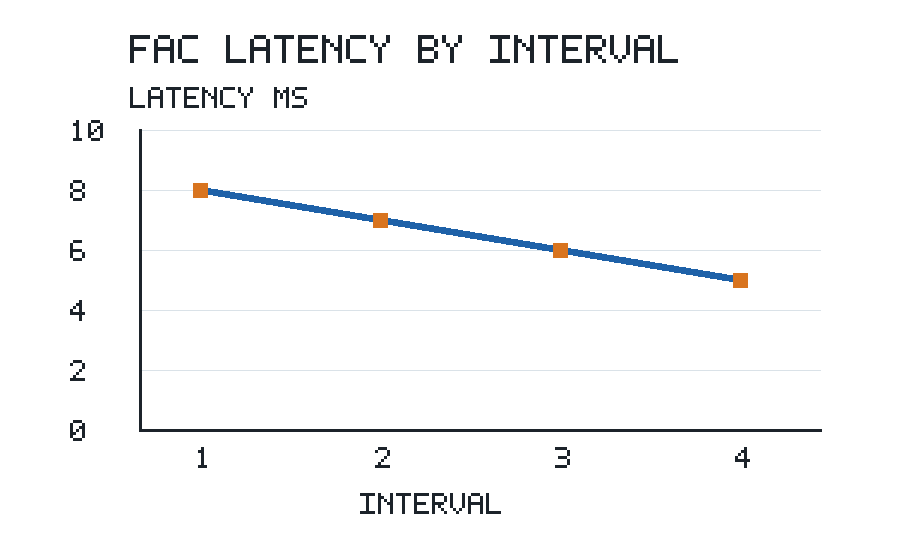
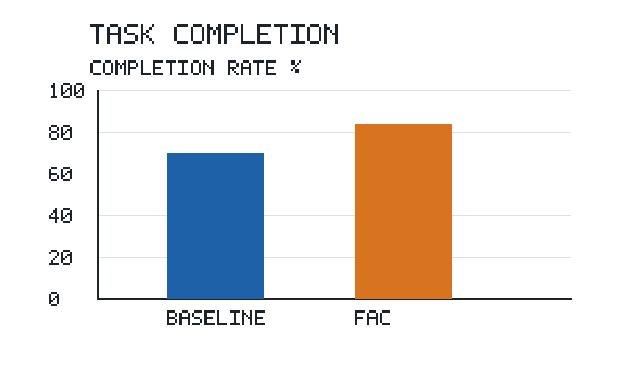

# Forecast-Aware Coordination for Distributed Multi-Agent Systems

**Synthetic test fixture.** All examples, observations, and results in this document are invented for software testing. They are not evidence about real systems.

## Abstract

We study forecast-aware coordination (FAC) for a simulated distributed agent system. In a fixed-ring scenario with 20 agents, FAC reduces total communication overhead by 25% relative to a no-forecast baseline. FAC also improves task completion and is scalable to large agent populations.

## Introduction

Our objective is to evaluate whether FAC changes communication and task completion relative to a no-forecast coordinator. We consider a fixed-ring network and use synthetic workloads. Our main claims concern communication, task completion, and scalability.

## Methodology

The FAC scheduler uses a forecast to decide which agents exchange messages. Let the signed forecast error $e_i$ be the observed demand minus the predicted demand for forecast window $i$. Equation (1) defines this error:

$$e_i = \hat{y}_i - y_i. \tag{1}$$

Here $y_i$ is observed demand and $\hat{y}_i$ is predicted demand, both measured in requests. No absolute value is applied to the signed error.

## Experimental setup

The ring experiment uses 20 agents and the same workloads for baseline and FAC. Total communication overhead is the number of messages, including both topology maintenance and task payload messages, summed across the evaluation horizon. The reduction is $(\mathrm{baseline}-\mathrm{FAC})/\mathrm{baseline}\times100\%$. Task completion rate is completed tasks divided by submitted tasks. No other population sizes were evaluated for these two comparisons. There are no independent test runs beyond the single summarized simulation.

## Results

In the 20-agent fixed-ring experiment, Table 1 records the total number of messages for each coordinator over the same evaluation horizon.

**Table 1. Communication overhead in the 20-agent fixed-ring experiment.**

| Coordinator | Total messages |
| --- | ---: |
| Baseline | 100 |
| FAC | 82 |

In the 20-agent fixed-ring experiment, the mean latency reported to one decimal place is 6.7 ms. The more precise value in Table 2 is 6.67 ms. For a separate 40-agent star-topology exploratory run, the mean latency is 10.0 ms. These values describe different operating conditions; no direct performance comparison between them is claimed.

**Table 2. Mean latency under separate conditions.**

| Scenario | Mean latency (ms) |
| --- | ---: |
| 20-agent ring | 6.67 |
| 40-agent star | 10.00 |

Figure 1 shows FAC latency in the fixed-ring simulation rising from interval 1 through interval 4. The measurements underlying the figure are provided in `latency.csv`.

Figure 2 shows task completion at 70% for the baseline and 84% for FAC in the same 20-agent ring simulation. The measurements underlying the figure are provided in `completion.csv`.

Figure 3 summarizes an additional run; its image is unavailable in this fixture and the values are not reported in the text.

Figure 4 is referenced as a supplemental topology diagram, but is not included in the available manuscript or materials.

## Discussion

In this single simulation, FAC completed 84% of submitted tasks while the baseline completed 70%, a 14 percentage-point difference. The study evaluated only the 20-agent ring for task completion; the exploratory 40-agent star run provides latency only. No result for robustness across workload shifts is claimed.

## Conclusion

FAC reduced total communication overhead by 22% relative to the no-forecast baseline in the 20-agent fixed-ring experiment. Our architecture demonstrates general scalability to large agent populations. Its observed completion rate improved from 70% to 84% in the tested 20-agent ring. No data about other system sizes or network conditions are available for the scalability claim.
